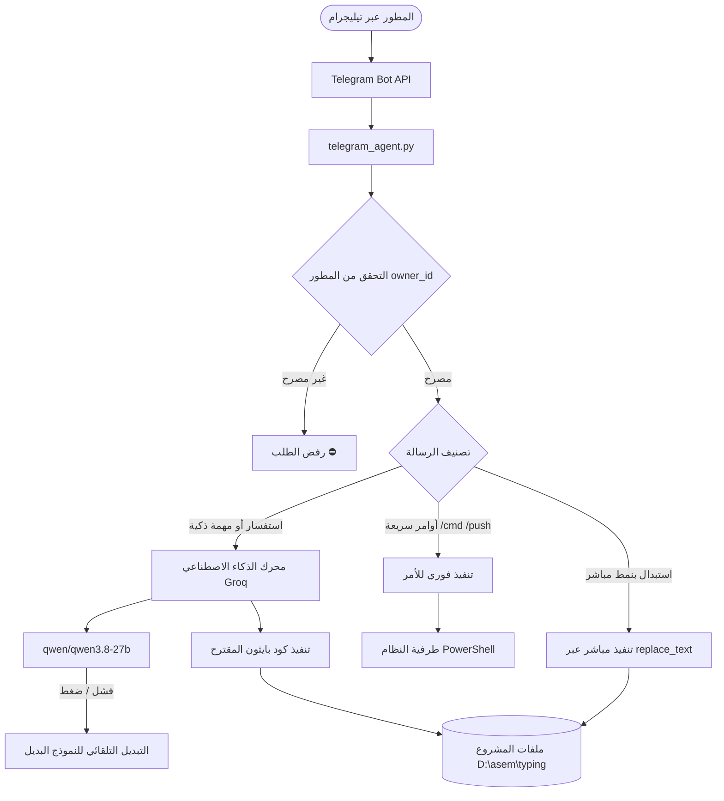

# 🤖 دليل ربط وتشغيل وكيل تيليجرام التنفيذي (Autonomous Developer Agent)

يوثق هذا الدليل طريقة ربط مشروع **BarqType** بتطبيق **تيليجرام (Telegram)** لتحويل البوت إلى **وكيل برمجي تنفيذي (Autonomous Agent)** قادر على قراءة وتعديل ملفات المشروع، استبدال النصوص، تنفيذ أوامر النظام، وحفظ ورفع التحديثات على GitHub مباشرة عبر المحادثة.

---

## 📑 فهرس المحتويات
1. [نظرة عامة على معمارية النظام](#1-نظرة-عامة-على-معمارية-النظام)
2. [المتطلبات الأساسية](#2-المتطلبات-الأساسية)
3. [خطوات الربط والإعداد خطوة بخطوة](#3-خطوات-الربط-والإعداد-خطوة-بخطوة)
4. [آلية عمل المحرك الذكي ومعالجة الطلبات](#4-آلية-عمل-المحرك-الذكي-ومعالجة-الطلبات)
5. [أوامر التحكم السريعة في تيليجرام](#5-أوامر-التحكم-السريعة-في-تيليجرام)
6. [طرق إرسال أوامر التعديل والاستبدال](#6-طرق-إرسال-أوامر-التعديل-والاستبدال)
7. [إدارة وتشغيل البوت في الخلفية (Windows PowerShell)](#7-إدارة-وتشغيل-البوت-في-الخلفية)
8. [أمان المفاتيح وحماية Push Protection على GitHub](#8-أمان-المفاتيح-وحماية-push-protection)
9. [استكشاف الأخطاء وحلولها (Troubleshooting)](#9-استكشاف-الأخطاء-وحلولها)

---

## 1. نظرة عامة على معمارية النظام

يعتمد الوكيل على معمارية هجينة تجمع بين:
- **المسار السريع الفوري (Fast-Path Regex Execution):** للطلبات المباشرة (مثل استبدال النصوص، الحذف، التعديل متعدد الأسطر) ويتم تنفيذها في أجزاء من الثانية دون استهلاك توكنز الذكاء الاصطناعي ودون الاعتماد على خوادم خارجية.
- **المحرك التنفيذي الذكي (AI Executive Engine):** لمعالجة الطلبات البرمجية المعقدة عبر نماذج Groq فائقة السرعة (مثل `Qwen 3.8 27B` و `Allam Arabic`)، مع دعم كامل للتبديل التلقائي (`Auto-Failover`) والتعافي الذكي من أخطاء استدعاء الأدوات (`Tool-use Recovery`).
- **بيئة التنفيذ الآمنة (Dynamic Execution Sandbox):** مكتبة دوال بايثون داخلية مخصصة للتحكم في ملفات المشروع وأوامر PowerShell.



---

## 2. المتطلبات الأساسية

1. **بيئة بايثون:** Python 3.10 أو أحدث.
2. **المكتبات البرمجية:**
   ```bash
   pip install python-telegram-bot google-generativeai
   ```
3. **توكن بوت تيليجرام (Bot Token):** يتم استخراجه مجاناً من بوت [@BotFather](https://t.me/BotFather).
4. **مفتاح مزود الذكاء الاصطناعي (مجاني):**
   - **Groq API Key:** من لوحة تحكم [Groq Console](https://console.groq.com/keys) (يبدأ بـ `gsk_`).
   - *(اختياري)* **Gemini API Key:** من لوحة [Google AI Studio](https://aistudio.google.com/) (يبدأ بـ `AIza`).

---

## 3. خطوات الربط والإعداد خطوة بخطوة

### الخطوة 1: إنشاء البوت والحصول على التوكن
1. افتح تطبيق تيليجرام وابحث عن `@BotFather`.
2. أرسل الأمر `/newbot`.
3. اختر اسماً للبوت (مثال: `My Dev Agent`) واسم مستخدم ينتهي بـ `_bot` (مثال: `asem_antigravity_bot`).
4. انسخ رمز التوكن (Token) الناتج (مثال: `8897239334:AAE699QTKV...`).

### الخطوة 2: إنشاء ملف الإعدادات `telegram_config.json`
في المجلد الرئيسي للمشروع (`d:\asem\typing`)، يتم حفظ الإعدادات في ملف `telegram_config.json` بالشكل التالي:

```json
{
  "bot_token": "ضع_توكن_البوت_هنا",
  "owner_id": 6019813605,
  "groq_api_key": "gsk_ضع_مفتاح_جروك_هنا",
  "groq_model": "qwen/qwen3.8-27b",
  "gemini_api_key": "",
  "active_provider": "groq"
}
```

> [!TIP]
> إذا لم تكن تعرف معرف حسابك في تيليجرام (`owner_id`)، اتركه فارغاً أو `null`، وعند تشغيل البوت وإرسال أول أمر `/start` من حسابك، سيقوم البوت تلقائياً باعتماد حسابك كمالك وحيد للمشروع وحفظه في الإعدادات.

---

## 4. آلية عمل المحرك الذكي ومعالجة الطلبات

### 1) المسار السريع (Instant Fast-Path):
يقوم الوكيل بفحص الرسالة لحظياً عبر التعبيرات القياسية (Regex):
- إذا كانت الرسالة متعددة الأسطر وتبدأ بطلب تعديل، يفحص البوت الملفات لمعرفة أيهما النص الموجود حالياً ويستبدله بالآخر فوراً.
- إذا كانت الرسالة استبدالاً صريحاً بصيغة `قم باستبدال النص X الى Y بس`، يستخلص النصين ويجري الاستبدال فوراً.

### 2) المحرك الاستدلالي (AI Engine With Auto-Failover):
إذا تطلبت المهمة تفكيراً برمجياً:
1. يتم إرسال الطلب إلى نموذج `qwen/qwen3.8-27b`.
2. في حال حدوث أي خطأ في الخادم (مثل 400 أو 413 أو 429)، لا يتوقف البوت، بل ينتقل تلقائياً إلى النماذج البديلة:
   - `qwen/qwen3.8-27b`
   - `allam-2-7b` (نموذج علام العربي)
   - `openai/gpt-oss-120b`
   - `openai/gpt-oss-20b`

### 3) صائد استدعاء الأدوات الذكي (Tool-use Recovery):
عندما تحاول بعض النماذج استدعاء دوال خارجية أو بيئات حاوية ويظهر خطأ:
```text
Tool choice is none, but model called a tool
```
يقوم البوت باعتراض الخطأ داخلياً، وتحليل كائن `failed_generation`، واستخراج كود بايثون أو أمر النظام المقصود وتنفيذه بنجاح تام للمستخدم.

---

## 5. أوامر التحكم السريعة في تيليجرام

يمكنك إرسال هذه الأوامر مباشرة داخل محادثة البوت:

| الأمر | الشرح |
| :--- | :--- |
| `/start` | تشغيل الوكيل وتوثيق هوية المطور وعرض معلومات النموذج النشط |
| `/help` | عرض قائمة المساعدة والدليل السريع للأوامر |
| `/status` | فحص حالة Git الحالية ومعرفة الملفات المعدلة |
| `/push <رسالة>` | حفظ جميع التعديلات ورفعها إلى GitHub فوراً (`git add . ; commit ; push`) |
| `/replace قديم => جديد` | استبدال مباشر وسريع لنص في كافة ملفات المشروع دون انتظار الذكاء الاصطناعي |
| `/search <نص>` | بحث سريع عن وجود أي كلمة أو دالة في كافة ملفات المشروع برقم السطر |
| `/files` | استعراض كافة الملفات المسجلة في مستودع Git |
| `/cmd <أمر>` | تشغيل أي أمر نظام في PowerShell في مجلد المشروع واستعراض النتائج |
| `/models` | عرض النماذج المتاحة والتبديل بينها (مثال: `/models allam-2-7b`) |
| `/setkey <مفتاح>` | تحديث مفتاح Groq (`gsk_...`) أو Gemini (`AIza...`) مباشرة من الشات |

---

## 6. طرق إرسال أوامر التعديل والاستبدال

يمكنك التعديل على ملفات المشروع بطرق متعددة يفهمها الوكيل بسلاسة:

### الطريقة الأولى: الرسائل متعددة الأسطر (الأكثر دقة ومرونة)
```text
قم بتعديل هذا النص
تم الإنشاء والتطوير بواسطة المبرمج عاصم السلمي
تم الإنشاء والتطوير بواسطة المبرمج الفلوس
```
*سيفحص البوت ملفات المشروع تلقائياً لتحديد أي السطرين موجود بالفعل، ويقوم باستبداله بالسطر الآخر في كافة ملفات النظام.*

### الطريقة الثانية: الرسائل المباشرة باللغة الطبيعية
```text
قم باستبدال العاصم بن صالح الى الفلوس بس
```
أو:
```text
استبدل Asem Alselme بـ عاصم السلمي
```

### الطريقة الثالثة: أمر الاستبدال المباشر
```text
/replace النص القديم => النص الجديد
```
*(لحذف النص تماماً، اترك ما بعد `=>` فارغاً).*

### الطريقة الرابعة: الأوامر البرمجية والطلبات العامة
يمكنك أيضاً طلب أي تعديل عام باللغة العربية مثل:
- "أضف مؤثراً صوتياً عند الفوز في صفحة `learn.html`"
- "ابحث عن دالة `buildKeyboard` في المشروع واعرض كودها"
- "افحص حالة Git وارفع التعديلات باسم تحديث الفوتر"

---

## 7. إدارة وتشغيل البوت في الخلفية

### 1) التشغيل اليدوي المباشر:
داخل مجلد المشروع عبر PowerShell:
```powershell
python telegram_agent.py
```

### 2) التشغيل كعملية خلفية (Background Process):
لتشغيل البوت بحيث يستمر في العمل حتى لو أغلقت نافذة الأوامر:
```powershell
Start-Process -FilePath "python" -ArgumentList "telegram_agent.py" -WorkingDirectory "d:\asem\typing" -WindowStyle Hidden
```

### 3) معرفة معرّف العملية (ProcessId) للبوت الشغال:
```powershell
Get-WmiObject Win32_Process -Filter "name = 'python.exe'" | Where-Object { $_.CommandLine -like "*telegram_agent*" } | Select-Object ProcessId, CommandLine
```

### 4) إيقاف البوت أو إعادة تشغيله:
```powershell
# إيقاف عملية البوت (استبدل 19680 برقم المعرف الحالي لديك)
Stop-Process -Id 19680 -Force

# تشغيل البوت من جديد
python telegram_agent.py
```

---

## 8. أمان المفاتيح وحماية Push Protection

> [!CAUTION]
> لا تضع أبداً مفاتيح الـ API أو توكن التيليجرام داخل ملف `telegram_agent.py` نفسه، لأن ميزة GitHub Secret Scanning / Push Protection ستقوم بحظر الرفع إلى GitHub فوراً!

- يتم حفظ المفاتيح حصراً داخل ملف:
  [`telegram_config.json`](file:///d:/asem/typing/telegram_config.json)
- تأكد دائماً أن ملف `telegram_config.json` موجود داخل ملف:
  [`.gitignore`](file:///d:/asem/typing/.gitignore)
- ملف [`.gitignore`](file:///d:/asem/typing/.gitignore) الحالي يتضمن:
  ```gitignore
  telegram_config.json
  telegram_owner.json
  *.bak
  ```

---

## 9. استكشاف الأخطاء وحلولها

### 1) خطأ: `Tool choice is none, but model called a tool`
- **السبب:** قيام بعض نماذج Groq بمحاولة استدعاء أدوات داخلية لبيئات Docker أو Linux.
- **الحل:** تم حله جذرياً في كود `telegram_agent.py` عبر تفعيل نموذج `qwen/qwen3.8-27b` الافتراضي، وإضافة معالج التقاط لـ `failed_generation` لتحويل استدعاء الأدوات تلقائياً إلى كود تنفيذي.

### 2) خطأ: `Conflict: terminated by other getUpdates request`
- **السبب:** وجود نسختين من ملف `telegram_agent.py` تعملان في نفس الوقت على جهازك بنفس الـ Token.
- **الحل:** قم بإنهاء كافة عمليات البوت القديمة:
  ```powershell
  Get-Process python | Where-Object { $_.MainWindowTitle -like "*telegram*" } | Stop-Process -Force
  ```
  ثم أعد تشغيل البوت مرة واحدة فقط.

### 3) عدم استجابة البوت للرسائل:
- تأكد أن معرف حسابك هو المسجل في `owner_id` داخل `telegram_config.json`.
- أرسل الأمر `/start` للتأكد من اتصال البوت بالإنترنت.
